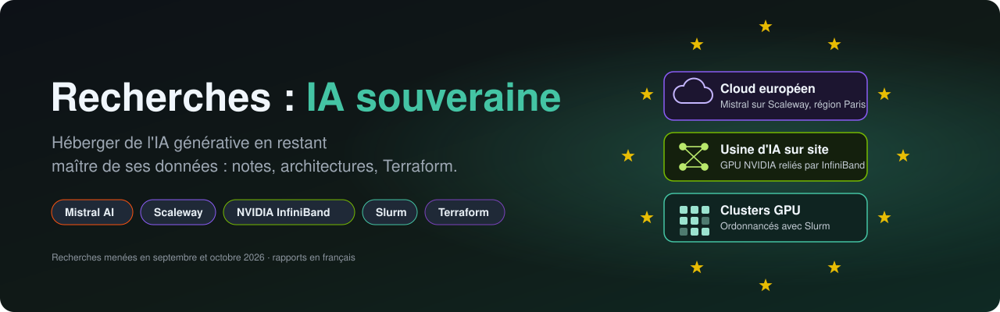
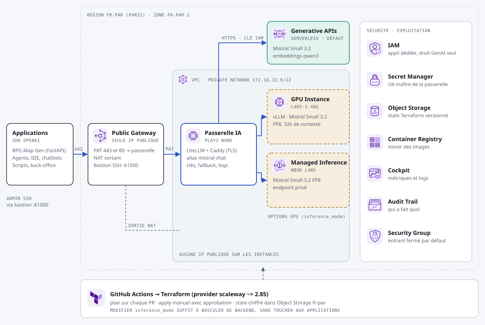
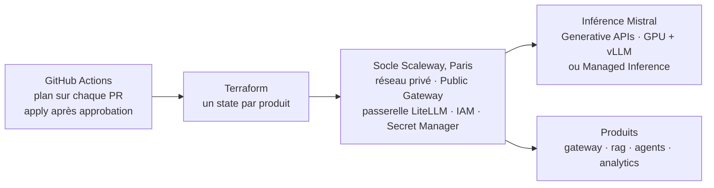

<p align="center">
  
</p>

<p align="center">
  
  <a href="https://www.terraform.io"></a>
  <a href="https://www.scaleway.com"></a>
  <a href="https://mistral.ai"></a>
  <a href="https://www.nvidia.com/fr-fr/networking/products/infiniband/"></a>
  <a href="https://slurm.schedmd.com"></a>
  <a href=".github/workflows"></a>
</p>

<p align="center">
  <b>Héberger de l'IA générative en restant maître de ses données</b><br>
  notes techniques, architectures et templates Terraform : Mistral sur Scaleway, usine d'IA NVIDIA InfiniBand sur site, clusters GPU Slurm.
</p>

<p align="center">
  <a href="#rapports">Rapports</a> ·
  <a href="#code-scaleway">Code Scaleway</a> ·
  <a href="#demarrer">Démarrer</a> ·
  <a href="scaleway/README.md">Déployer</a> ·
  <a href="#avertissements">Avertissements</a>
</p>

---

## En bref

- **10 rapports** sous forme de pages HTML autonomes, avec schémas, sources et points à vérifier.
- **Cloud européen** : Mistral sur Scaleway, en région Paris. Architecture cible, modes d'inférence, coûts.
- **Usine d'IA sur site** : GPU NVIDIA reliés par InfiniBand, du simulateur ibsim à la fabric commutée.
- **Clusters GPU** : ordonnancement avec Slurm, POC exécuté sur fabric simulée.
- **4 produits Terraform** déployables depuis GitHub Actions (API Mistral, RAG, agents, analyse) sur un socle commun.
- **Sécurité par défaut** : instances privées, API en échec fermé, secrets dans Secret Manager, déploiement soumis à approbation.

<a id="rapports"></a>

## Rapports

> Les rapports sont des pages HTML autonomes. Ouvrez-les dans un navigateur, ou publiez le dépôt avec GitHub Pages (*Settings > Pages > Deploy from a branch*, dossier racine) : [`index.html`](index.html) sert alors de sommaire.

### Scaleway : Mistral souverain dans le cloud européen

| Rapport | Contenu |
|---|---|
| [Mistral souverain sur Scaleway](rapports/scaleway/mistral-souverain-sur-scaleway.html) | Architecture cible : passerelle d'API unique, Generative APIs, Managed Inference ou GPU dédiés, RAG pgvector. Plan de déploiement et coûts |
| [IA souveraine Scaleway](rapports/scaleway/ia-souveraine-scaleway.html) | État des GPU et des modèles Mistral disponibles, six idées de projets, trois modes d'inférence, déploiement depuis GitHub |
| [Catalogue IA souveraine](rapports/scaleway/catalogue-ia-souveraine.html) | Trois produits packagés (RAG, agents, analyse) sur un socle commun, avec schémas et mise en route |

### NVIDIA et InfiniBand : usine d'IA sur site

| Rapport | Contenu |
|---|---|
| [Usine d'IA souveraine NVIDIA](rapports/nvidia-infiniband/usine-ia-souveraine-nvidia.html) | Quantum-X800, SHARP, ConnectX-8, CUDA-Q et NVQLink. Architecture sur site et niveaux de déploiement |
| [Intégration InfiniBand souveraine](rapports/nvidia-infiniband/integration-infiniband-souveraine.html) | Fiche technique Quantum-X800, architecture de référence, recette, certifications NVIDIA |
| [Upper Layer Protocols InfiniBand](rapports/nvidia-infiniband/upper-layer-protocols-infiniband.html) | IPoIB, SRP, iSER, NFS RDMA, MPI, NCCL… Fiche de révision NCP-AIN avec auto-évaluation |
| [Le Subnet Manager InfiniBand](rapports/nvidia-infiniband/subnet-manager-infiniband.html) | Fonctionnement, configuration et exploitation du SM sur les plateformes NVIDIA |
| [Le matériel du Subnet Manager](rapports/nvidia-infiniband/materiel-subnet-manager.html) | Commutateurs managés, appliances UFM, cartes ConnectX, DPU BlueField : références et prix |
| [Lab InfiniBand local](rapports/nvidia-infiniband/lab-infiniband-local.html) | Parcours en quatre niveaux, du simulateur ibsim (testé) à la fabric commutée |

### Slurm : ordonnancement de clusters GPU

| Rapport | Contenu |
|---|---|
| [Slurm pour clusters GPU souverains](rapports/slurm/slurm-clusters-gpu-souverains.html) | Architecture, lien avec InfiniBand (topologie, santé, P_Key), POC exécuté sur fabric simulée, écosystème NVIDIA |

<a id="code-scaleway"></a>

## Code : IA souveraine sur Scaleway

Le dossier [`scaleway/`](scaleway/README.md) contient quatre produits Terraform déployables depuis GitHub Actions. Ils partagent le même socle : réseau privé, passerelle d'API compatible OpenAI et modèles Mistral. Seule la couche applicative change d'un produit à l'autre.

<p align="center">
  
</p>

| Produit | Pour quoi faire | Briques applicatives |
|---|---|---|
| [`gateway`](scaleway/products/gateway/README.md) | API Mistral compatible OpenAI pour vos applications | LiteLLM |
| [`rag`](scaleway/products/rag/README.md) | Discuter avec ses documents, réponses sourcées | Open WebUI, PostgreSQL + pgvector |
| [`agents`](scaleway/products/agents/README.md) | Construire des agents et des workflows, les appeler en API | Langflow, MCP Scaleway (option) |
| [`analytics`](scaleway/products/analytics/README.md) | Interroger ses données en français, tableaux de bord | ClickHouse, Superset, Open WebUI |

### Comment ça marche



- **Validation :** la configuration passe `terraform validate` et `terraform fmt` hors ligne, avec le provider `scaleway/scaleway` 2.85.0. Aucun produit n'a encore été déployé.
- **Workflows :** ils sont dans `.github/workflows/`. Ils attendent les secrets décrits dans [`scaleway/README.md`](scaleway/README.md).
- **Serveur MCP :** `.mcp.json` configure le serveur MCP Scaleway en lecture seule pour Claude Code. Les identifiants viennent des variables d'environnement `SCW_*` et ne sont jamais stockés dans le dépôt.
- **Sécurité :** le déploiement est en échec fermé par défaut (la passerelle répond `403` tant que `allowed_api_cidrs` n'est pas renseigné). Les réglages de durcissement sont détaillés dans [`scaleway/README.md`](scaleway/README.md#sécurité-par-défaut).

<a id="demarrer"></a>

## Démarrer

**Lire les rapports :** clonez le dépôt et ouvrez [`index.html`](index.html) dans un navigateur, ou activez GitHub Pages.

**Déployer un produit sur Scaleway :**

```bash
cd scaleway
scw init                 # profil administrateur
./scripts/bootstrap.sh   # bucket de state + application IAM pour GitHub Actions
```

Enregistrez ensuite les secrets affichés dans GitHub, créez l'environnement `scaleway-prod` avec des *required reviewers*, puis lancez *Actions > sovereign-ai / terraform*. Toutes les étapes : **[scaleway/README.md](scaleway/README.md#déployer-un-produit)**.

## Technologies

| | Technologie | Rôle dans ce dépôt |
|---|---|---|
|  | [Scaleway](https://www.scaleway.com) | Cloud européen, région Paris : réseau privé, instances, Generative APIs, Managed Inference, bases managées |
|  | [Mistral AI](https://mistral.ai) | Modèles servis par la passerelle (Mistral Small 3.2 par défaut) |
|  | [Terraform](https://www.terraform.io) | Les quatre produits et leur socle commun |
|  | [GitHub Actions](https://docs.github.com/actions) | `fmt`, `validate` et `plan` sur chaque PR ; `apply`, `destroy` et copie des images après approbation |
|  | [NVIDIA InfiniBand](https://www.nvidia.com/fr-fr/networking/products/infiniband/) | Usine d'IA sur site : Quantum-X800, ConnectX, Subnet Manager, UFM |
| | [Slurm](https://slurm.schedmd.com) | Ordonnancement des clusters GPU |
| | [LiteLLM](https://www.litellm.ai) | Passerelle d'API compatible OpenAI, clés et repli |
| | [Open WebUI](https://openwebui.com), [Langflow](https://www.langflow.org), [Superset](https://superset.apache.org) | Applications des produits `rag`, `agents` et `analytics` |

## Organisation

```
rapports/            pages HTML autonomes, par thème
  scaleway/          Mistral sur Scaleway
  nvidia-infiniband/ usine d'IA et fabric InfiniBand
  slurm/             clusters GPU
scaleway/            templates Terraform, schémas, scripts
  modules/           socle commun : platform, app-host, postgres
  products/          gateway, rag, agents, analytics
.github/workflows/   plan et apply Terraform, copie des images vers Scaleway
docs/assets/         bannière
index.html           sommaire des rapports (GitHub Pages)
```


<a id="architecture-deploiement"></a>

## Architecture de deploiement (branche infra/scaleway-mistral-test)

Une architecture IA souveraine a 3 niveaux est documentee sur la branche <code>infra/scaleway-mistral-test</code> :

| Niveau | Cible | Hebergement | Documentation |
|---|---|---|---|
| Confidentiel Defense | OIV, defense, secret industriel | On-premise air-gapped, Slurm + InfiniBand | <a href="docs/architecture/01-niveau-confidentiel-defense.md">doc</a> · <a href="docs/architecture/schemas/niveau-secret-infiniband.svg">schema</a> |
| Entreprise Cloud | ETI, grands comptes, secteur regule | Scaleway fr-par, Kubernetes, Mistral Compute | <a href="docs/architecture/02-niveau-entreprise-cloud.md">doc</a> |
| TPE/PME SaaS | TPE, PME, independants | Vibe Enterprise manage, Mistral API UE | <a href="docs/architecture/03-niveau-tpe-pme-saas.md">doc</a> |

Schemas : <a href="docs/architecture/schemas/architecture-globale.svg">architecture globale</a> · <a href="docs/architecture/schemas/flux-donnees.svg">flux de donnees</a>

Deploiement : <a href="docs/deploiement/llm-gateway-litellm.md">LiteLLM Gateway</a> · <a href="docs/deploiement/slurm-infiniband-onprem.md">Slurm InfiniBand on-prem</a> · <a href="docs/deploiement/scaleway-terraform.md">Terraform Scaleway</a>

Agent Vibe : <a href=".vibe/agents/souverain-architect.toml">souverain-architect</a>


<a id="avertissements"></a>

## Avertissements

- **Chiffres datés :** prix, stocks et versions ont été relevés à une date donnée. Vérifiez-les avant tout engagement.
- **Sources :** certaines pages officielles n'étaient pas lisibles depuis l'environnement de rédaction. Chaque rapport indique ses sources et ce qui reste à vérifier.
- **Mentions tierces :** voir [`NOTICE.md`](NOTICE.md).

## Contact

Questions, remarques ou corrections : ouvrez une **[issue](https://github.com/4math2379/Recherches-IA-Souveraine/issues)**.
