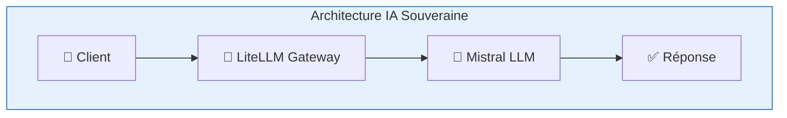

# 🧪 Test rendu Mermaid sur GitHub

Ce fichier teste si GitHub rend correctement les blocs `mermaid` dans les fichiers `.md`.

## Schéma test — Architecture 3 niveaux

## Si tu vois un diagramme ci-dessus → Mermaid fonctionne ✅
## Si tu vois juste du texte brut → il faut changer d'approche ❌
