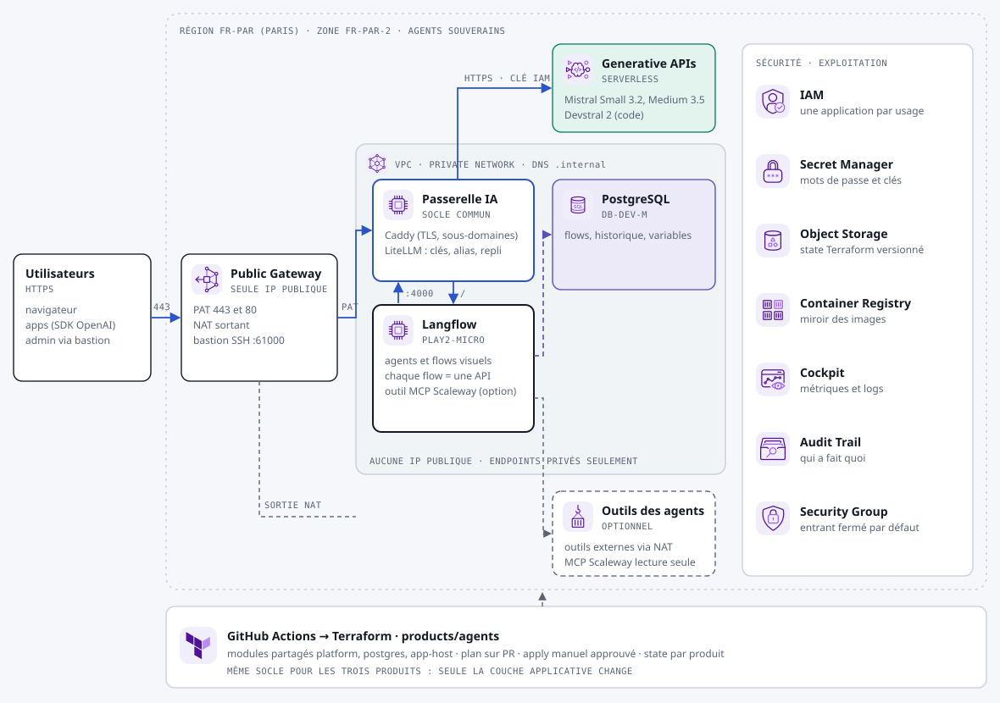

# Produit « Agents » : agents et workflows souverains

Construisez des agents à la souris (outils, mémoire, appels d'API, enchaînements), testez-les, puis appelez chaque flow comme une API. Les modèles sont Mistral, servis à Paris par la passerelle.



## Ce qui est déployé

| Composant | Service Scaleway | Rôle |
|---|---|---|
| Socle | voir le [README principal](../../README.md#le-socle-commun) | Réseau privé, Public Gateway, passerelle IA |
| Application | Instance `PLAY2-MICRO` (8 Go) | [Langflow](https://github.com/langflow-ai/langflow) (licence MIT) : éditeur visuel, exécution, API REST et serveur MCP pour chaque flow |
| État | Managed PostgreSQL 17, `DB-DEV-M`, endpoint privé, chiffré | Flows, historique, variables globales |
| Modèles | Generative APIs via la passerelle | `mistral-chat` (Mistral Small 3.2, appel d'outils), `mistral-medium` (Medium 3.5, raisonnement), `devstral` (Devstral 2, code), `embeddings` |
| Outil (option) | Serveur MCP Scaleway, lecture seule | Les agents peuvent interroger votre infrastructure : instances, bases, coûts. Une application IAM dédiée avec `AllProductsReadOnly` sur le projet |

## Après le premier `apply`

1. **Connexion :** ouvrez l'output `app_url` et connectez-vous avec l'utilisateur `admin`. Pour le mot de passe :

   ```bash
   scw secret version access $(terraform output -raw admin_password_secret_id | cut -d/ -f2) revision=latest raw=true
   ```

2. **Modèle :** dans un flow, ajoutez le composant de modèle OpenAI et réglez-le ainsi :
   - **API Key :** la variable globale `OPENAI_API_KEY` ;
   - **OpenAI API Base :** la variable globale `OPENAI_API_BASE` (l'URL interne de la passerelle) ;
   - **Model Name :** `mistral-chat`.
3. **Outil MCP Scaleway (si `enable_scaleway_mcp = true`) :** ajoutez le composant *MCP Tools*, en *Streamable HTTP*, avec l'URL `http://scaleway-mcp:8090/mcp`.
4. **Publication :** chaque flow s'appelle en API (`/api/v1/run/<flow>`) avec une clé créée dans *Settings > API Keys*.

## Réglages

Dans `env/prod.tfvars` :

- **`platform` :** domaine, plages autorisées et mode d'inférence. `allowed_api_cidrs` est obligatoire : vide, l'application répond `403` (échec fermé).
- **`enable_scaleway_mcp` :** l'outil MCP Scaleway, désactivé par défaut.
- **`app_instance_type` et `db_node_type` :** la taille de l'instance et de la base.

## Sécurité des agents

- **Sortie internet :** les agents sortent sur internet par le NAT de la Public Gateway. Pour une liste blanche, ajoutez un proxy sortant, ou des règles sortantes au groupe de sécurité.
- **Outil MCP Scaleway :** il est en lecture seule (`read-only=true`) et son application IAM n'a que des droits de lecture. Ne lui donnez jamais de droits d'écriture sans validation humaine dans le flow.
- **Clé Scaleway :** elle est dans un fichier d'environnement séparé, invisible pour Langflow.

## À vérifier au premier déploiement

- **Composant OpenAI de Langflow :** selon la version, le nom de modèle se choisit dans une liste. Si `mistral-chat` n'y figure pas, saisissez-le comme valeur personnalisée.
- **Chemin MCP :** le chemin `/mcp` du serveur MCP Scaleway en *Streamable HTTP* est à confirmer.
- **Image :** `langflow:latest` est une version mouvante. Fixez une version.
