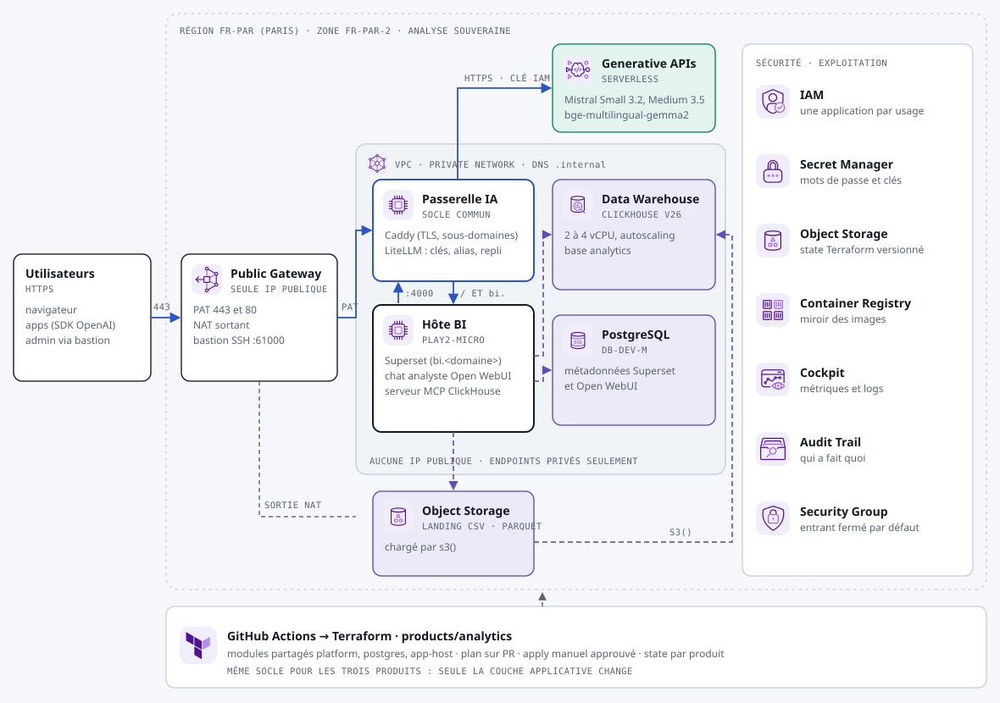

# Produit « Analyse » : interroger ses données en français

Déposez vos fichiers CSV ou Parquet, chargez-les dans un entrepôt ClickHouse managé, puis posez vos questions en français à un assistant qui écrit et exécute le SQL, en lecture seule. Les tableaux de bord se font dans Superset.



## Ce qui est déployé

| Composant | Service Scaleway | Rôle |
|---|---|---|
| Socle | voir le [README principal](../../README.md#le-socle-commun) | Réseau privé, Public Gateway, passerelle IA |
| Entrepôt | Data Warehouse for ClickHouse v26, 1 réplica, 2 à 4 vCPU, endpoint privé uniquement | Base `analytics`. Administrateur `scwadmin`, utilisateur `analyst` en lecture |
| Dépôt de fichiers | Object Storage `fr-par`, versionné | CSV et Parquet, lus par ClickHouse avec `s3()` grâce à une clé en lecture seule |
| Hôte BI | Instance `PLAY2-MICRO` (8 Go) | [Superset](https://superset.apache.org) 5.0 (Apache 2.0) sur `bi.<domaine>` ; [Open WebUI](https://github.com/open-webui/open-webui) sur `<domaine>`, le chat analyste ; [serveur MCP ClickHouse](https://github.com/ClickHouse/mcp-clickhouse) (Apache 2.0) en lecture seule |
| Métadonnées | Managed PostgreSQL 17, `DB-DEV-M` | Superset et Open WebUI |
| Modèles | Generative APIs via la passerelle | `mistral-chat`, `mistral-medium` (meilleur en SQL complexe), `embeddings` |

Scaleway propose aussi un Superset managé (*Cloud Essentials for Apache Superset*). Il n'a pas encore de ressource Terraform, c'est pourquoi Superset est hébergé ici sur l'instance.

## Après le premier `apply` : deux étapes en plus

L'endpoint privé de ClickHouse présente un certificat signé par une autorité Scaleway. Il faut le récupérer, puis relancer `apply` :

```bash
scw datawarehouse deployment get-certificate <id-du-deploiement> > clickhouse-ca.pem
```

Collez le contenu dans `clickhouse_ca_cert` (variable `TF_VAR_clickhouse_ca_cert` en CI), puis relancez `apply`. L'hôte BI est recréé. Au démarrage, il :

- donne `SELECT` sur `analytics.*` à l'utilisateur `analyst` ;
- connecte Superset à ClickHouse ;
- configure le serveur MCP.

Ensuite :

1. **Compte administrateur du chat :** ouvrez l'output `chat_url` et créez-le immédiatement. Le premier compte créé devient administrateur.
2. **Outil SQL :** dans *Administration > Réglages > Outils externes*, ajoutez un serveur MCP en *Streamable HTTP* : URL `http://clickhouse-mcp:8000/mcp`, authentification *Bearer*. Le jeton est dans le secret de l'output `bi_secret_id`.
3. **Superset :** ouvrez l'output `bi_url` et connectez-vous avec `admin`. Le mot de passe est dans le même secret.

## Charger des données

Déposez un fichier dans le bucket de l'output `landing_bucket`. Les clés de lecture sont dans le secret de l'output `clickhouse_secret_id`. Puis, connecté en `scwadmin` :

```sql
CREATE TABLE analytics.ventes ENGINE = MergeTree ORDER BY tuple() AS
SELECT * FROM s3('https://s3.fr-par.scw.cloud/<bucket>/ventes.parquet', '<access_key>', '<secret_key>');
```

Puis dans le chat : « Quel est le chiffre d'affaires par mois sur 2026 ? »

## Réglages

Dans `env/prod.tfvars` :

- **`clickhouse_cpu_min`, `clickhouse_cpu_max` et `clickhouse_replicas` :** l'entrepôt (autoscaling CPU). Mettez 2 réplicas ou plus pour la haute disponibilité.
- **`app_instance_type` :** passez à 16 Go en production (Superset et Open WebUI sur la même instance).
- **`clickhouse_mcp_package` :** fixez une version du paquet (`mcp-clickhouse==x.y.z`).

## À vérifier au premier déploiement

- **Image Superset :** la commande `uv pip install` dans l'image correspond à Superset 5.0. Pour une autre version, adaptez le `Dockerfile` intégré au fichier `templates/compose.yaml.tftpl`.
- **Connexion Superset :** `superset set-database-uri` crée la connexion `ClickHouse`. Vérifiez-la dans *Settings > Database Connections*.
- **Port HTTPS :** il est lu dans les services de l'endpoint privé, avec 8443 par défaut.
- **Utilisateur `analyst` :** il ne doit jamais recevoir de droits d'écriture. Le serveur MCP refuse déjà les écritures (`CLICKHOUSE_ALLOW_WRITE_ACCESS=false`).
