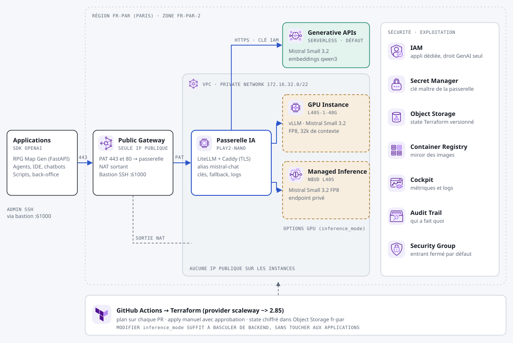

# Produit « Passerelle » : API Mistral souveraine

Une API compatible OpenAI, servie par Mistral chez Scaleway à Paris. C'est le socle commun utilisé seul, pour brancher vos propres applications.



## Ce qui est déployé

Le socle décrit dans le [README principal](../../README.md#le-socle-commun), et rien d'autre.

## Après le premier `apply`

```bash
KEY=$(scw secret version access $(terraform output -raw master_key_secret_id | cut -d/ -f2) revision=latest raw=true)
curl $(terraform output -raw api_base_url)/chat/completions -H "Authorization: Bearer $KEY" \
  -H "Content-Type: application/json" \
  -d '{"model":"mistral-chat","messages":[{"role":"user","content":"Bonjour"}]}'
```

Modèles exposés : `mistral-chat`, `embeddings` (qwen3-embedding-8b) et, avec un backend dédié, `mistral-chat-serverless`.

Avec le SDK OpenAI, il suffit de changer `base_url` et `api_key`.

## Changer de backend

Dans `env/prod.tfvars`, changez `inference_mode` dans l'objet `platform` (`gpu_instance` ou `managed_inference`), puis lancez `apply`. Les applications ne changent pas. L'instance passerelle est recréée : quelques minutes de coupure.
