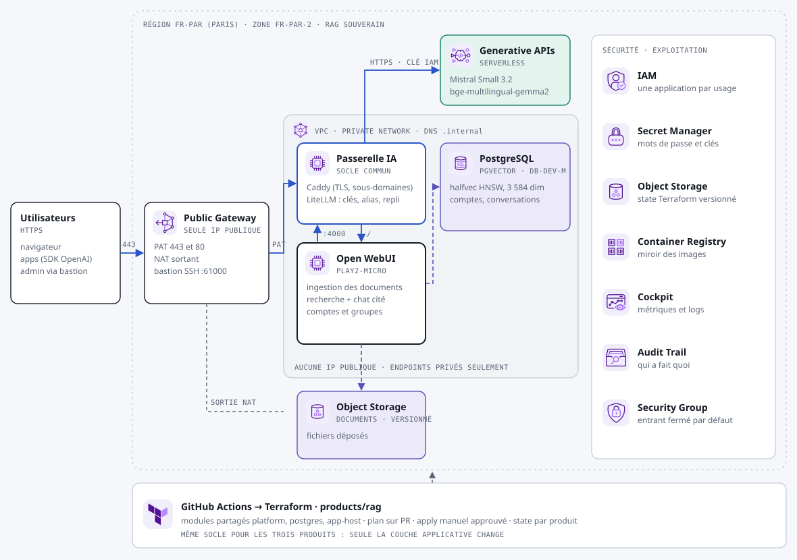

# Produit « RAG » : discuter avec ses documents

Les utilisateurs déposent leurs documents (PDF, Word, pages web) et posent leurs questions en français. Les réponses citent les passages sources. Tout est hébergé chez Scaleway à Paris : documents, vecteurs, conversations et modèles.

## Ce qui est déployé

| Composant | Service Scaleway | Rôle |
|---|---|---|
| Socle | voir le [README principal](../../README.md#le-socle-commun) | Réseau privé, Public Gateway, passerelle IA |
| Application | Instance `PLAY2-MICRO` (8 Go) | [Open WebUI](https://github.com/open-webui/open-webui) : interface de chat, ingestion des documents, recherche, comptes et groupes |
| Vecteurs et données applicatives | Managed PostgreSQL 17, `DB-DEV-M`, endpoint privé, chiffré, sauvegarde quotidienne | pgvector (index HNSW en `halfvec`), comptes, conversations |
| Documents | Object Storage `fr-par`, versionné | Fichiers déposés, via une application IAM limitée aux objets |
| Modèles | Generative APIs via la passerelle | `mistral-chat` (Mistral Small 3.2) et `embeddings` (`bge-multilingual-gemma2`) |

**Pourquoi `bge-multilingual-gemma2` :** ses vecteurs font 3 584 dimensions. L'index HNSW de pgvector en `halfvec` accepte jusqu'à 4 000 dimensions, ce que ne respecte pas `qwen3-embedding-8b` (4 096). Le modèle est aussi multilingue et bon en français. Sa licence est celle de Gemma, à vérifier pour votre usage.

## Après le premier `apply`

1. **Compte administrateur :** ouvrez l'output `app_url` et créez-le immédiatement. Le premier compte créé devient administrateur, les suivants attendent une validation.
2. **Base de connaissances :** dans *Espace de travail > Connaissances*, créez une base et déposez-y les documents.
3. **Utilisation :** dans une conversation, tapez `#` pour choisir la base de connaissances, puis posez la question.

Les réglages sont portés par Terraform (`ENABLE_PERSISTENT_CONFIG=false`) : une modification faite dans l'interface d'administration est perdue au redémarrage. Faites-la dans `main.tf`.

## Réglages

Dans `env/prod.tfvars` :

- **`platform` :** domaine, plages autorisées et mode d'inférence. `allowed_api_cidrs` est obligatoire : vide, l'application répond `403` (échec fermé). Pour un corpus sensible : `inference_mode = "managed_inference"` et `serverless_fallback = false`.
- **`app_instance_type` :** `PLAY2-MICRO` par défaut. Passez à 16 Go au-delà de quelques dizaines d'utilisateurs simultanés.
- **`db_node_type` et `db_high_availability` :** la base de données.

## À vérifier au premier déploiement

- **Licence d'Open WebUI :** BSD-3 avec une clause de marque depuis la v0.6.6. Le logo ne peut pas être retiré au-delà de 50 utilisateurs sans licence entreprise. Lisez-la avant de revendre le produit en marque blanche.
- **Image :** `open-webui:main` est une version mouvante. Fixez une version.
- **Volumétrie :** `DB-DEV-M` (4 Go de RAM) convient pour quelques milliers de documents. Surveillez la taille de l'index dans Cockpit.
